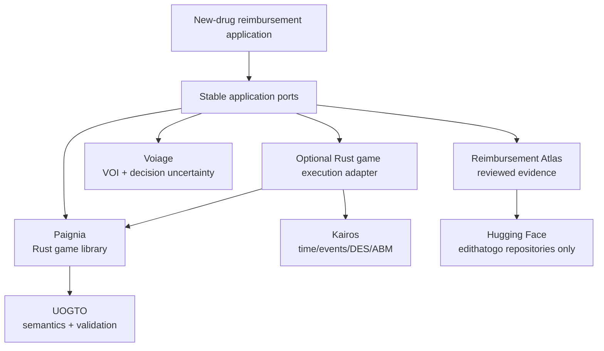

# New Drug Reimbursement Game

An ecosystem-first, clean-room research-software implementation inspired by
Brita A. K. Pekarsky's *The New Drug Reimbursement Game* (Springer, 2015).

This repository owns the reimbursement application: price-effectiveness
analysis, specific games, payoff construction, evidence and interpretation.
The reusable game capability is [**Paignia**](https://github.com/edithatogo/paignia),
a separate Rust library originally incubated here. The application consumes its
`paignia-core` and `paignia-solve` packages at one immutable Git revision; no
parallel local game core is maintained.

The repository does **not** contain the book, copied figures, copied tables, or
substantial source text. It implements equations and concepts independently and
cites the source.

## Ecosystem-first rule

When a capability already exists, or is being developed, in the `edithatogo`
ecosystem, that capability is authoritative:

| Concern | Authoritative component | This repository's role |
|---|---|---|
| Game-theory semantics | [`edithatogo/UOGTO`](https://github.com/edithatogo/UOGTO) | Application extension and executable conformance fixtures |
| Simulation, time, events, ECS, DES/ABM | [`edithatogo/kairos`](https://github.com/edithatogo/kairos) | Adapter contract only; no second scheduler |
| Value of information | [`edithatogo/voiage`](https://github.com/edithatogo/voiage) | Convert reimbursement outcomes to Voiage inputs |
| Reimbursement evidence | [`edithatogo/reimbursement-atlas`](https://github.com/edithatogo/reimbursement-atlas) | Consume reviewed derived records; no parallel data lake |
| Hugging Face assets | [`edithatogo/*`](https://huggingface.co/edithatogo) only | Manifests and derived configs; no third-party Hub dependency |
| General game capability | [Paignia](https://github.com/edithatogo/paignia) | Immutable Rust dependency; domain models/payoffs stay here; release qualification remains open |

No runtime dependency on Nashpy, Gambit/pygambit, OpenSpiel, BCEA, heemod, or
dampack is permitted. Generic implementation libraries may be used only through
an explicit dependency decision and migration ledger.

## Architecture



Domain models and payoff construction stay in the application. Its native
integration test calls Paignia's public APIs; optional runtime integrations use
ports. The current pure-Python solver is a small conformance oracle. The Rust
packages `paignia-core` and `paignia-solve` are maintained in Paignia and
consumed through the application Cargo manifest and lockfile.

Static game representation and solving have no Kairos dependency. The optional
adapter executes a selected policy and chance process through Kairos; a solver's
diagnostic visits to hypothetical branches are not simulation events. The
[T17 plan](conductor/tracks/t17_game_runtime_ecosystem_20261107/index.md) separates
bounded static package qualification from native integration and the pending
advanced numerical methods. The former
`uogto-game-core` / `uogto-game-solve` sources have moved into Paignia. Its
repository exists; registry publication and real-consumer release qualification
remain open. See the [source transfer and retention map](docs/architecture/paignia-transfer-map.md)
and [Paignia/T17 ownership record](conductor/tracks/t17_game_runtime_ecosystem_20261107/paignia-identity-and-promotion.md).

## Implemented now

- Price-effectiveness analysis (PEA) primitives: IPER, reimbursement health
  effect, net economic benefit in health units, economic value of clinical
  innovation, and the health shadow price.
- Strict, source-mapped evaluators for all four Chapter 7 economic scenarios,
  including the Appendix 5 investment formulation for `mu`, alongside a
  separately labelled generalized opportunity-set API.
- Analytic Chapter-8-style revealed-threshold equilibrium under explicit
  assumptions.
- A domain-neutral finite perfect-information game model and backward-induction
  solver in Rust, plus a small Python conformance oracle.
- UOGTO-aligned RDF/JSON-LD application extension and SHACL proposal.
- Ports/adapters for Voiage, Kairos, UOGTO, and local exports from Reimbursement
  Atlas.
- A strict approved-derived parameter-evidence packet, deterministic Chapter 7
  calibration receipts, and aligned Voiage `ValueArray`/`ParameterSet` handoff.
- A fail-closed NHS England methodological candidate dossier and deterministic
  readiness receipt covering every Chapter 7 scenario without promoting public
  estimates into approved calibration evidence.
- An `edithatogo`-only Hugging Face manifest.
- Research synthesis and a post-2015 extension map.
- Upstream proposal packets for UOGTO, Kairos, Voiage, and Reimbursement Atlas.
- A comprehensive Codex implementation prompt.

## Bundle-first Codex handoff

The v0.4.0 handoff is designed to be copied into an otherwise empty parent
folder. Its outer covering prompt restores this repository from a Git bundle,
which preserves the original history and tags. Codex then executes
`CODEX_REPOSITORY_ACTIVATION_PROMPT.md` inside the checkout to create or safely
wire the GitHub remote, resolve the pinned owner-controlled ecosystem clones,
activate Conductor, and continue autonomously into
`CODEX_IMPLEMENTATION_PROMPT.md`.

The source ZIP is supplied as an auditable fallback tree, but the Git bundle is
the authoritative restoration path. See `START_HERE_CODEX.md` and
`docs/GITHUB_BOOTSTRAP.md`.

## Quick start

```bash
python -m reimbursement_game.cli evaluate examples/cases/chapter8_example.json
python -m reimbursement_game.cli scenario examples/cases/chapter7_scenario4.json
python -m reimbursement_game.cli evidence fixtures/evidence/synthetic-chapter7-parameter-packet-v1.json
python -m reimbursement_game.cli pilot-readiness fixtures/evidence/nhs-england-methodological-candidates-v1.json
python -m reimbursement_game.cli calibrate fixtures/evidence/synthetic-chapter7-parameter-packet-v1.json scenario_3 120 20 --case-id synthetic-demo --record n=n-allocative --record m=m-contraction --record d=d-displacement
python -m reimbursement_game.cli equilibrium examples/cases/chapter8_example.json
python -m reimbursement_game.cli sweep --output-dir docs/figures
python -m reimbursement_game.cli uogto examples/cases/chapter8_example.json
python scripts/validate_scope.py
```

For Rust:

```bash
cargo test --workspace
cargo run -p new-drug-reimbursement-game
cargo test --locked -p new-drug-reimbursement-game --test paignia_static_game
```

### Native Paignia consumer example

The `paignia_static_game` integration test constructs a finite firm-offer and
institution-response game, computes its payoffs with the existing application
health-benefit function, and calls Paignia backward induction. The synthetic
case uses expansion ICER 25,000, contraction/displacement ICER 50,000, and health
gain 4. Offers of 20,000, 25,000 and 30,000 per health unit give institution
benefits 0.8, 0 and −0.8. With acceptance at indifference and zero incremental
manufacturing cost, the highest accepted offer is 25,000, total firm revenue
100,000, and institution benefit zero. These values give an analytic check
independent of the solver's output.

The finite offer grid is an illustrative restriction of the Chapter 8 Game 1
assumptions, using Chapter 7 equations 7.2–7.5 and Chapter 8 equation 8.2
(Pekarsky, 2015; DOI below). It does not alter the full application model or
provide empirical validation. Utilities retain each player's own units; Paignia
compares alternatives within a player. The current lexical tie rule selects
`accept` over `reject` at zero benefit. This native consumer case has an explicit dependency/validation record in
T17. It does not complete provider T17.03 / application T17.09 release
qualification, the second real application receipt, or S01–S04 scientific work.

## Source and citation

Primary conceptual source:

> Pekarsky, B. A. K. (2015). *The New Drug Reimbursement Game: A
> Regulator's Guide to Playing and Winning*. Springer.
> https://doi.org/10.1007/978-3-319-08903-4

See `docs/research/pekar​sky-foundation.md`, `REFERENCES.md`, and
`CITATION.cff`. The soft hyphen-like character in the path above is avoided in
actual filenames; the file is `docs/research/pekarsky-foundation.md`.

## Status

This is research software consuming the Paignia native game library. It is not a reimbursement
recommendation, an HTA submission, or regulator-grade software. See
`IMPLEMENTATION_STATUS.md` and `docs/governance/model-risk.md`.

The committed evidence fixture is synthetic and explicitly prohibited from
decision use. Real calibration requires approved Atlas-derived records and
independent health-economic review; see
`docs/architecture/evidence-calibration-contract.md`.
The NHS England pilot remains candidate-only; see
`docs/research/nhs-england-methodological-pilot.md`.
